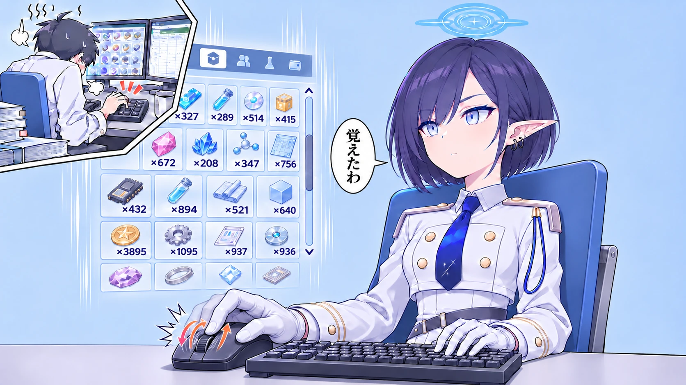
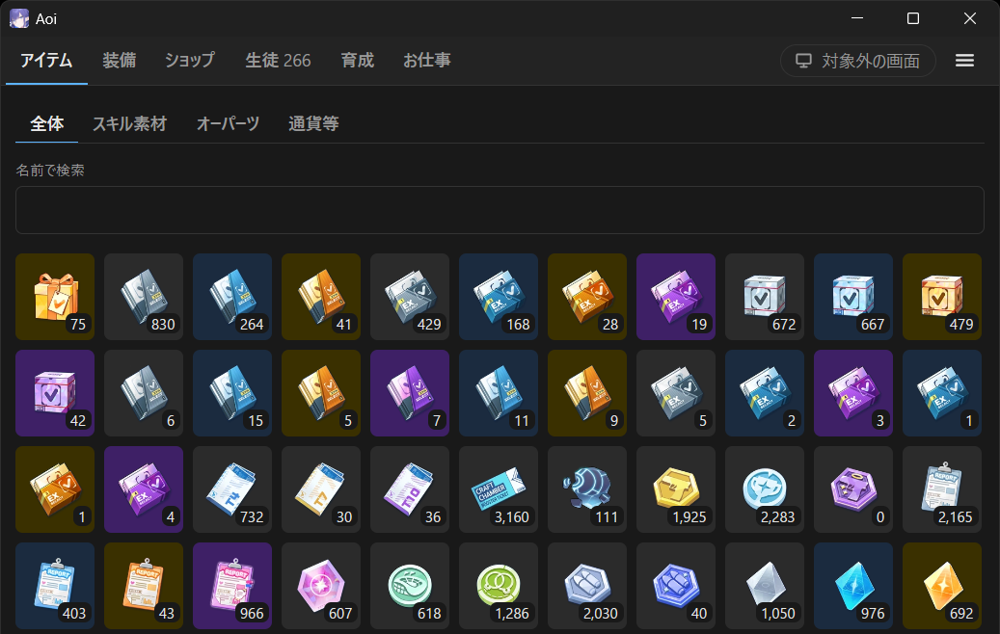
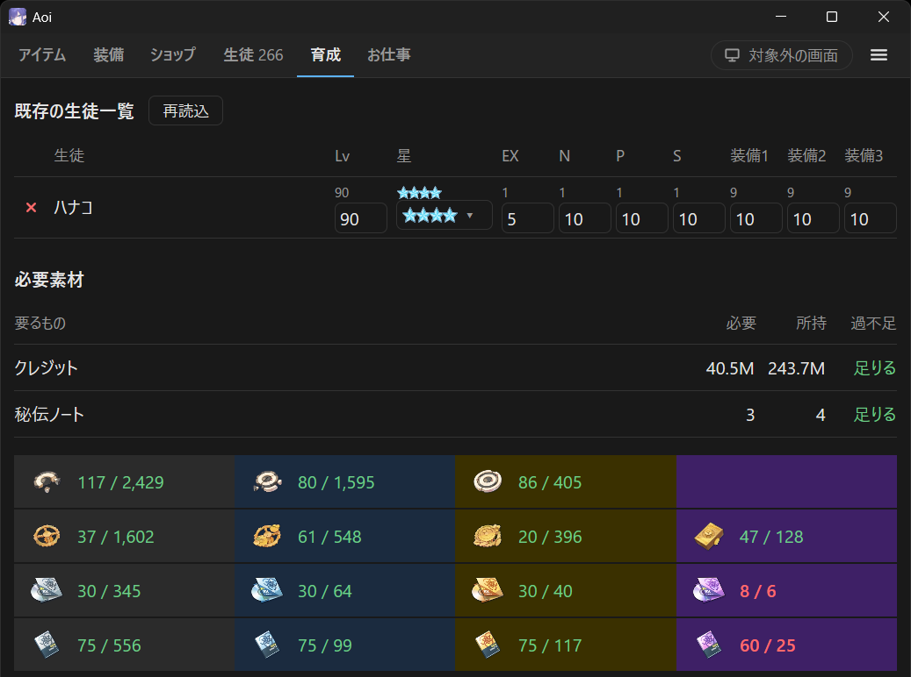

# Aoi

<b>A free app that counts your Blue Archive materials, works out how many students they train, and suggests where to farm.</b>

<a href="#download-and-run"><b>Download</b></a> | <a href="https://miyabisun.github.io/bluearchive-aoi/">Guide with animated diagrams (Japanese)</a> | <a href="README.md">日本語</a>

<b>Scroll the game's lists and Aoi remembers the counts.</b> Without Aoi, you would read them yourself and type them into a spreadsheet.

<b>Aoi works out how many students your materials train.</b> Without Aoi, you would build the formulas and calculate it again.

<b>Aoi suggests where to farm.</b> Without Aoi, you would decide by looking back and forth between the game and the spreadsheet.

## Download and run

These steps put Aoi on a Windows 11 PC. It reads the Japanese version of Blue Archive, and shows names in Japanese.

1. **[Download Aoi here](https://github.com/miyabisun/bluearchive-aoi/releases/latest/download/bluearchive-aoi-x86_64-pc-windows-msvc.exe)**.
2. Double-click the downloaded file. There is nothing to install: it starts as it is.
3. If Windows SmartScreen shows "Windows protected your PC", choose "More info", then "Run anyway".

If you play on a phone, or want Aoi on a Mac → [Phones and Mac](#phones-and-mac)

Why step 3 appears, where to keep the file, updates

- The notice of step 3 appears because the app is made by an individual and is not signed.
- The file is `bluearchive-aoi-x86_64-pc-windows-msvc.exe`. It is also under "Assets" on the [latest release](https://github.com/miyabisun/bluearchive-aoi/releases/latest).
- Keep it in any folder you can write to, such as your desktop or Documents.
- Do not keep it in a folder that needs an administrator to write to, such as Program Files: the update cannot replace it there.
- For a newer version, open the settings with "≡" at the top right of Aoi and choose アップデートを確認. If there is one, 更新して再起動 replaces the app and starts it again.

## Use

1. Start Aoi and Blue Archive, in either order.
2. In the game, open the item or equipment list sorted by デフォルト ascending, a student's 基本情報 tab, or a shop, and scroll or step through it slowly.
3. In Aoi's 生徒 tab, mark the students you train under 育成.
4. The 育成 tab shows the materials they need and how many you lack, and lets you choose how to make them up from the choice boxes and the shops.

What step 2 has read appears in Aoi's tabs.

The 育成 tab of step 4. Each material shows "needed / held"; the red numbers are the materials you lack.

The step-by-step guides are in Japanese: [reading the game](https://miyabisun.github.io/bluearchive-aoi/guide/reading.html), [the 育成 tab](https://miyabisun.github.io/bluearchive-aoi/guide/plan.html), [the お仕事 tab](https://miyabisun.github.io/bluearchive-aoi/guide/work.html) and [troubleshooting](https://miyabisun.github.io/bluearchive-aoi/guide/trouble.html).

What Aoi counts, and what else it does

- Aoi counts the items and equipment you hold, how far your students are trained, and how many more times the shops sell each of their goods.
- With the PC version, keep Aoi open next to the game.
- The お仕事 tab suggests what to collect in missions, bounties and the like, and which shop goods to buy at the end of the month.

## Phones and Mac

If you play on a phone, put Aoi on a computer first, then send the phone's screen to Aoi.

| You play on | You need                                                                                      | Steps (Japanese)                                                          |
| ----------- | --------------------------------------------------------------------------------------------- | ------------------------------------------------------------------------- |
| Android     | A phone with Android 11 or later, and a Windows 11 PC or a Mac. A USB cable or the same Wi-Fi | [Android](https://miyabisun.github.io/bluearchive-aoi/guide/android.html) |
| iPhone      | An iPhone with a streaming app (Moblin), and a Windows 11 PC or a Mac on the same Wi-Fi       | [iPhone](https://miyabisun.github.io/bluearchive-aoi/guide/stream.html)   |

Aoi on a Mac and reading an iPhone are not tried yet.

Putting Aoi on a Mac, and how phones send their screen

- The macOS version is [`bluearchive-aoi-universal-apple-darwin.dmg`](https://github.com/miyabisun/bluearchive-aoi/releases/latest/download/bluearchive-aoi-universal-apple-darwin.dmg), for Apple silicon and Intel Macs.
- It is not notarized, so macOS blocks its first start: open it once, then choose Open Anyway in System Settings → Privacy & Security (steps in Japanese: [macOS](https://miyabisun.github.io/bluearchive-aoi/guide/mac.html)).
- The PC version of Blue Archive runs on Windows only, so the macOS version reads a phone's screen only. Its update check opens the release page instead of replacing the app.
- An Android phone needs no app: it sends its screen through USB or wireless debugging. An iPhone sends it through a streaming app (Moblin) over RTMP on the same Wi-Fi, as any phone can.

## The game and your data

- Aoi sends no input to the game: it only looks at the screen.
- What it reads stays on this computer.

When it goes online or talks to a phone

- It goes online only when アップデートを確認 looks for a newer version, and when it downloads that version.
- It talks to a phone only through the USB cable or within the same Wi-Fi.

## For developers

See [docs/dev](docs/dev/README.md).

## License

MIT ([LICENSE](LICENSE)). The bundled scrcpy server is under the Apache License 2.0 ([vendor/scrcpy](vendor/scrcpy)).
