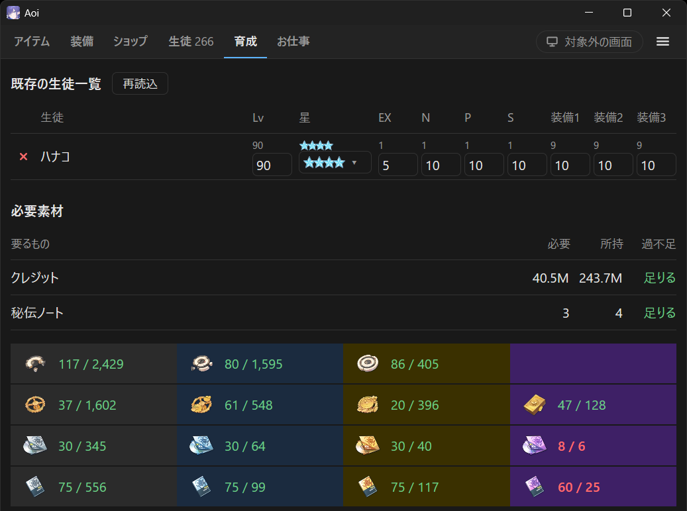
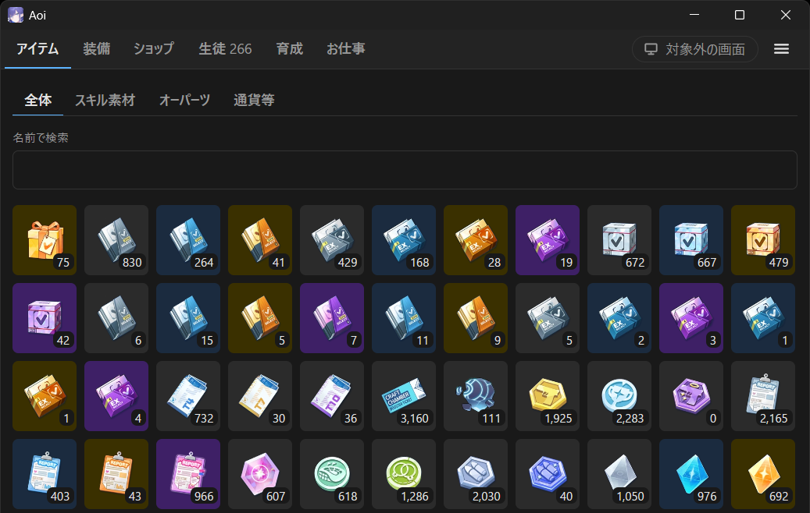

# Aoi（アオイ）

<b>ブルーアーカイブの育成で、素材が「あと何個足りないか」を数える無料のアプリです。</b> ゲームの画面を見せると、持っている数を Aoi が読み取ります。

「これは総決算どころではないわね……」 「少し集中するわ。タスクを整理するからリソースを見せてもらえるかしら？」

<a href="#ダウンロードと起動"><b>ダウンロード</b></a> ｜ <a href="https://miyabisun.github.io/bluearchive-aoi/">動く図で使い方を見る</a> ｜ <a href="README.en.md">English</a>

素材ごとに「必要な数 / 持っている数」が並びます。赤い数字が、足りない素材です。

## ダウンロードと起動

Windows 11 のパソコンに入れる手順です。読めるのは、PC 版・Android 版・iPhone 版とも、日本版のブルーアーカイブです。

1. **[ここを押して Aoi をダウンロード](https://github.com/miyabisun/bluearchive-aoi/releases/latest/download/bluearchive-aoi-x86_64-pc-windows-msvc.exe)** します。
2. ダウンロードしたファイルをダブルクリックします。インストールの作業はなく、そのまま起動します。
3. 「Windows によって PC が保護されました」と出たら、「詳細情報」→「実行」の順に押します。

スマホで遊んでいる人と、Mac に入れる人は → [スマホと Mac](#スマホと-mac)

手順 3 の表示が出る理由、ファイルの置き場所、アップデート

- 手順 3 の表示は、個人が作ったアプリで、電子署名が付いていないために出ます。
- ファイルの名前は `bluearchive-aoi-x86_64-pc-windows-msvc.exe` です。[最新版のリリースページ](https://github.com/miyabisun/bluearchive-aoi/releases/latest) の下の方にある「Assets」からもダウンロードできます。
- ファイルは、デスクトップや「ドキュメント」など好きな場所に置けます。
- 「Program Files」のような、書き込みに管理者の許可がいる場所には置かないでください。そこではアップデートで中身を入れ替えられません。
- 新しいバージョンが出たときは、Aoi の右上の「≡」で設定を開き、「アップデートを確認」を押します。新しいバージョンがあれば「更新して再起動」のボタンが出るので、押すと入れ替わって起動し直します。

## 使い方

1. Aoi とブルーアーカイブを起動します。どちらが先でも構いません。
2. ゲームで [アイテムと装備の一覧](https://miyabisun.github.io/bluearchive-aoi/guide/reading.html#アイテムと装備)・[生徒の詳細画面](https://miyabisun.github.io/bluearchive-aoi/guide/reading.html#生徒)・[ショップ](https://miyabisun.github.io/bluearchive-aoi/guide/reading.html#ショップ) を開いて、ゆっくりスクロールしたり送ったりします。
3. Aoi の生徒タブで、育てたい生徒の「育成」に印を付けます。
4. [育成タブ](https://miyabisun.github.io/bluearchive-aoi/guide/plan.html) に、必要な素材、足りない数、選択ボックスやショップでの補い方が出ます。

手順 2 で読めたものから、Aoi のタブに並びます。

うまく読めないときや、右上の表示の意味が分からないときは → [困ったとき](https://miyabisun.github.io/bluearchive-aoi/guide/trouble.html)

Aoi が数えるもの、ほかにできること

- 数えるのは、アイテムと装備の所持数、生徒の育成状況、ショップの残り購入回数です。
- PC 版では、Aoi をゲームの横に開いておきます。
- お仕事タブでは、任務や指名手配などで何を集めるとよいかの目安と、月末に買っておくショップの品を見られます。→ [お仕事タブの見方](https://miyabisun.github.io/bluearchive-aoi/guide/work.html)

## スマホと Mac

スマホで遊んでいる人は、パソコンに Aoi を入れてから、スマホの画面を Aoi に送ります。

| 遊んでいるもの | 必要なもの                                                                    | 手順                                                                                            |
| -------------- | ----------------------------------------------------------------------------- | ----------------------------------------------------------------------------------------------- |
| Android 版     | Android 11 以降のスマホと、Windows 11 の PC か Mac。USB ケーブルか同じ Wi-Fi  | [Android のスマホの画面を読む](https://miyabisun.github.io/bluearchive-aoi/guide/android.html)  |
| iPhone 版      | 配信アプリ（Moblin）を入れた iPhone と、同じ Wi-Fi の Windows 11 の PC か Mac | [配信アプリでスマホの画面を送る](https://miyabisun.github.io/bluearchive-aoi/guide/stream.html) |

Mac と iPhone での動作は、まだ確かめていません。

Mac に入れるとき

- macOS 版は [`bluearchive-aoi-universal-apple-darwin.dmg`](https://github.com/miyabisun/bluearchive-aoi/releases/latest/download/bluearchive-aoi-universal-apple-darwin.dmg) です。
- 入れ方と初めて開く手順は [macOS で初めて開く](https://miyabisun.github.io/bluearchive-aoi/guide/mac.html) にあります。
- ブルーアーカイブの PC 版は Windows 専用なので、macOS 版はスマホ（Android・iPhone）から送った画面を読みます。

## ゲームとデータの扱い

- ゲームは操作しません。画面を見るだけで、クリックやキー入力を送りません。
- 読み取った内容は、このパソコンの中だけに保存します。

インターネットやスマホとつなぐとき

- インターネットにつなぐのは、「アップデートを確認」で新しいバージョンを探すときと、そのバージョンをダウンロードするときだけです。
- スマホとは、USB ケーブルか同じ Wi-Fi の中だけでやり取りします。

## 開発者の方へ

技術的な資料（英語）は [docs/dev](docs/dev/README.md) にあります。

## ライセンス

MIT（[LICENSE](LICENSE)）。同梱する scrcpy のサーバーは Apache License 2.0（[vendor/scrcpy](vendor/scrcpy)）です。
